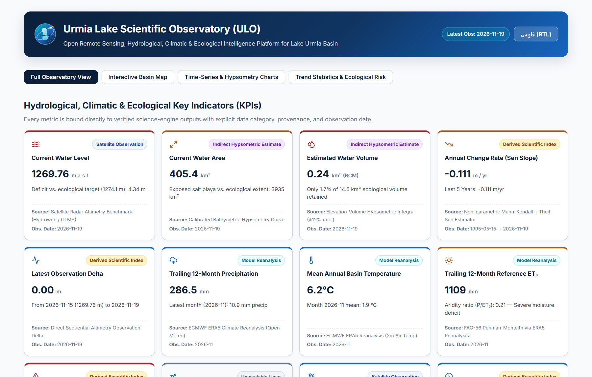
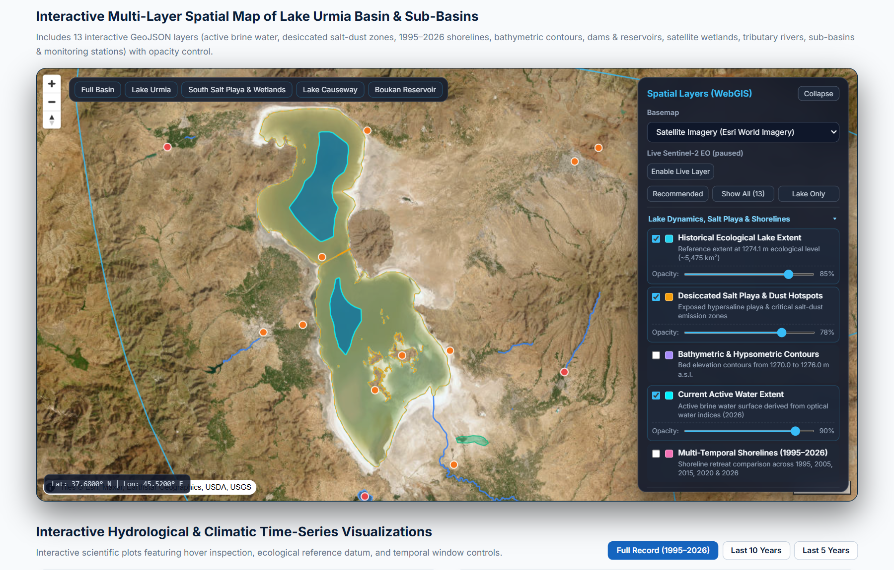
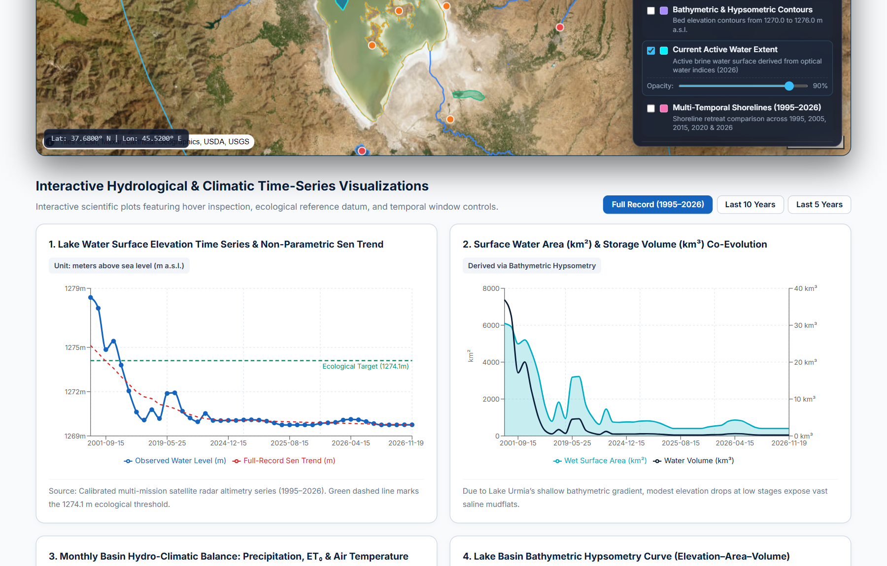

# URMIA LAKE OBSERVATORY (ULO)

**An Independent, Bilingual (English LTR / Persian RTL), Open-Science Hydrology, Climate, WebGIS & Decision-Support Platform for Lake Urmia and Its Endorheic Watershed Basin**

[](https://urmia-lake-observatory.pages.dev/)
[](https://fazeli1977-dot.github.io/Urmia-Lake-Observatory/)
[](QA_REPORT.md)
[](LICENSE)

---

## Live Public Access (100% Free — Zero Paid Backend)

- **Primary Production URL (Cloudflare Pages Global CDN):** https://urmia-lake-observatory.pages.dev/
- **Secondary Mirror (GitHub Pages):** https://fazeli1977-dot.github.io/Urmia-Lake-Observatory/
- **Source Code Repository:** https://github.com/fazeli1977-dot/Urmia-Lake-Observatory

---

## Dashboard Visual Showcase

### 1. Executive Hydrological, Climatic & Ecological KPIs
Real-time scientific KPI cards displaying satellite radar altimetry elevation, ecological target deficit (1274.1 m a.s.l.), hypsometric wet area & volume, ECMWF ERA5 climate balance, salinity/salt-dust risk score, and explicit Data Unavailable transparency wherever raw rasters are absent.



### 2. Interactive 13-Layer MapLibre GL WebGIS
Real OpenStreetMap & HydroSHEDS geometries covering the 51,876 km² watershed basin, sub-basins, major tributary rivers, dams & reservoirs, satellite wetlands, multi-temporal shoreline retreat (1995–2026), exposed salt-dust playas, bathymetric contours, opacity controls, and live Copernicus Sentinel-2 STAC catalog integration.



### 3. Multi-Decadal Time-Series, Hypsometry & Trend Analytics
Interactive ECharts visualizations for satellite altimetry water levels (1995–2026) with Theil-Sen trend line, coupled surface area & volume evolution, ECMWF ERA5 monthly precipitation vs. reference evapotranspiration (ET0), physical lakebed hypsometry, and non-parametric Mann-Kendall trend tables.


### 4. Scientific Research Center, Ramsar/GBIF Ecology & Decision Support (DSS)
Multi-period & deseasonalized same-month inter-annual benchmarks, Z-score anomaly & change-point detection, explicit **Hypothesis** labeling for unverified causal attributions, live **GBIF** basin biodiversity records (27,000+ occurrences), **Ramsar Site #38 (1975, Montreux Record)**, **UNESCO MAB Biosphere Reserve (1976)**, and a searchable **OpenAlex / Crossref** peer-reviewed library.



### 5. Local 8-Format Data Validation Sandbox & Bilingual PDF Report Generator
100% client-side security & schema validator (CSV, XLSX, JSON, GeoJSON, Shapefile ZIP, GeoTIFF, NetCDF, PDF) with Path Traversal & Magic-Byte guards, native multi-format exports (CSV, multi-sheet XLSX, JSON, GeoJSON, PNG), and print-ready bilingual A4 scientific **PDF** reports (English LTR & Persian RTL).


---

## Scientific Integrity & Six-Tier Data Provenance

Urmia Lake Observatory enforces a strict **Zero-Fabrication Policy**: no synthetic, placeholder, or simulated values are permitted in operational views. Every indicator carries full provenance metadata and is classified into six explicit scientific tiers:

| Tier | Category | Primary Sources Used in ULO |
|---|---|---|
| 1 | **Ground Observations** | GBIF Occurrence API v1, Ramsar Sites Information Service (Site #38), UNESCO MAB Registry |
| 2 | **Satellite Observations** | Hydroweb / CLMS Calibrated Radar Altimetry (1995–2026), Copernicus Sentinel-2 STAC API |
| 3 | **Model-Based Data** | ECMWF ERA5 Climate Reanalysis (Precipitation, Temperature, FAO-56 ET0) |
| 4 | **Derived Indicators** | Mann-Kendall Trend Test, Theil-Sen Slope, Z-Score Anomalies, Aridity Ratio (P/ET0), Same-Month Benchmarks |
| 5 | **Indirect Estimates** | Bathymetric Hypsometry (Area, Storage Volume, Brine Salinity with explicit ±12–15% uncertainty) |
| 6 | **User-Provided Data** | Locally validated researcher files processed strictly inside the browser (never uploaded to external servers) |

---

## Technical Architecture

The frontend visualization layer is strictly decoupled from the Python scientific data-processing engine:


```text
Urmia-Lake-Observatory/
├── web-dashboard/           # React 18, TypeScript, Vite 6, ECharts, MapLibre GL, Local Inter & Vazirmatn fonts
│   ├── src/
│   │   ├── components/      # KpiGrid, UrmiaMap, ScientificCharts, EcologicalAnalyticsPanel,
│   │   │                    # ScientificResearchCenter, DataManagementReports, UloLogo
│   │   ├── map/             # Basemaps, 13-layer WebGIS definitions, live Sentinel-2 STAC feed
│   │   └── utils/           # 8-format security/schema validator, native XLSX/CSV/GeoJSON/PNG/PDF engine
│   └── public/              # Pre-validated operational JSON datasets & 20 real GeoJSON spatial layers
├── science-engine/          # Python 3.12 analytics, trend testing & 17-test pytest QA suite
├── scripts/                 # Data sync, WebGIS builders, screenshot capture & rollback-safe update pipeline
├── data/                    # Raw, reference spatial, processed, archive snapshots & metadata logs
├── docs/                    # Architecture, deployment guides & dashboard screenshots
└── .github/workflows/       # Automated GitHub Pages CI/CD & weekly scheduled data update pipeline

```

---

## Automated Pipelines & Quality Assurance

- **Automated QA Suite (17/17 PASSED):** Covers geospatial topology & basin containment, hypsometric monotonicity, Mann-Kendall & Theil-Sen accuracy, schema completeness, RFC 7946 GeoJSON validation, hardcoded-secret/path security scans, and bilingual typography integrity ([QA_REPORT.md](QA_REPORT.md)).
- **Continuous Deployment (.github/workflows/deploy-pages.yml):** Runs automated pytest QA verification before building and publishing to GitHub Pages.
- **Automated Safe Data Refresh (.github/workflows/data-update-pipeline.yml):** Runs scripts/run_automated_data_update.py on a weekly schedule with automatic snapshot archiving (data/archive/) and corruption rollback protection.

---

## Local Development

### Run the Web Dashboard

```bash
cd web-dashboard
npm install
npm run dev

```

### Run the Python Scientific QA Suite

```bash
python -m pytest science-engine/tests -v

```

---

## Documentation Index

- [DEPLOYMENT.md](DEPLOYMENT.md) — Free hosting guide (GitHub Pages & Cloudflare Pages), free subdomain vs. custom domain comparison, and continuity limits
- [PROJECT_STATUS.md](PROJECT_STATUS.md) — Complete Phase 0–10 milestone verification
- [QA_REPORT.md](QA_REPORT.md) — Automated scientific, GIS, and security audit summary
- [ARCHITECTURE.md](ARCHITECTURE.md) — Modular system design and frontend/backend decoupling
- [DATA_SOURCES.md](DATA_SOURCES.md) — Verified free open-science APIs, licenses, and coverage
- [DATA_DICTIONARY.md](DATA_DICTIONARY.md) — Field schemas, units, and coordinate reference systems
- [METHODS.md](METHODS.md) — Statistical, hydrological, and remote-sensing methodology
- [SCIENTIFIC_LIMITATIONS.md](SCIENTIFIC_LIMITATIONS.md) — Uncertainty bounds, caveats, and data gaps
- [REFERENCES.md](REFERENCES.md) — Peer-reviewed scientific bibliography (OpenAlex / Crossref)

---

## Developer & Creator

- **Developer & Creator:** Alireza Fazeli Sani (علیرضا فاضلی ثانی)
- **Email:** alirezafazeli@live.com
- **License:** [MIT License](LICENSE)

> **Institutional Disclaimer:** Urmia Lake Observatory (ULO) is an independent, open-science research and decision-support platform. It claims no official affiliation with, endorsement by, or representation of NASA, ESA, USGS, UNESCO, or the Ramsar Convention Secretariat.